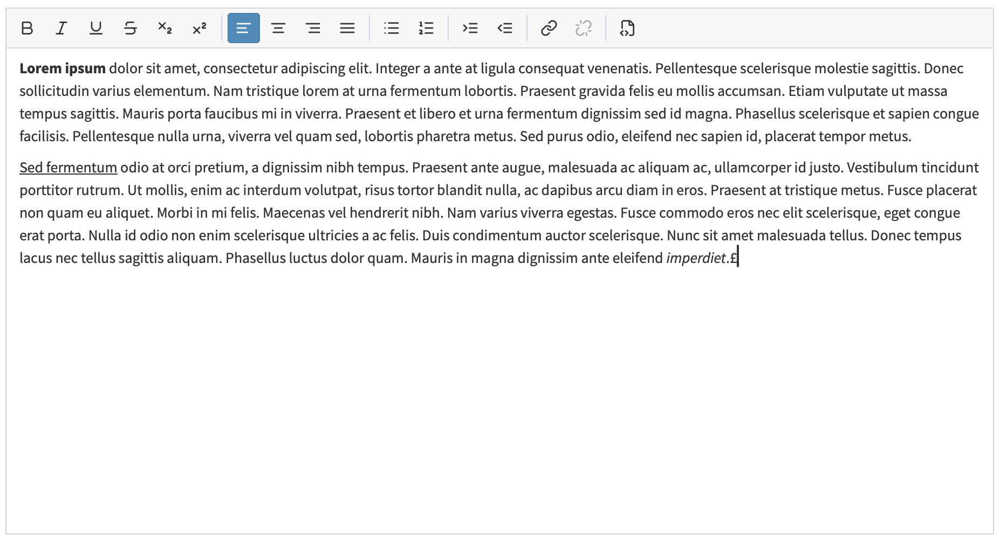

# FlexibleUxLexicalBundle

A reusable Symfony bundle providing **`LexicalFormType`** — a lightweight rich-text editor
form field built on Meta's [Lexical](https://lexical.dev), wired for
[AssetMapper](https://symfony.com/doc/current/frontend/asset_mapper.html),
[Stimulus](https://symfony.com/bundles/StimulusBundle) and
[UX Icons](https://symfony.com/bundles/ux-icons).

The field renders a toolbar (undo / redo, cut / copy / paste — including paste from Word —,
bold, italic, underline, strikethrough, subscript / superscript, remove format, text alignment,
bulleted / numbered lists, indentation, link, unlink, iframe embeds, HTML source editing) and a
contenteditable surface around a hidden `<textarea>`. The editor reads the
textarea's HTML on load and writes plain, semantic HTML back on every change, so it is a drop-in
replacement for a plain textarea and **degrades to that textarea when JavaScript is disabled**. No
build step is required — everything runs through AssetMapper's importmap.



## Requirements

- PHP 8.2+
- Symfony 7.4 or 8.x with AssetMapper, StimulusBundle and UX Icons

## Installation

Make sure [Composer is installed](https://getcomposer.org/doc/00-intro.md) globally.

### With Symfony Flex

```console
composer require flexible-ux/lexical-bundle
```

That is the whole installation. Flex registers the bundle in `config/bundles.php`, adds the Lexical
packages to your `importmap.php` (from the bundle's `assets/package.json`) and enables the `lexical`
Stimulus controller in `assets/controllers.json`. The bundle's recipe, kept in [`recipe/`](recipe/)
and submitted to [symfony/recipes-contrib](https://github.com/symfony/recipes-contrib), additionally
creates `config/packages/flexible_ux_lexical.yaml` with every application-wide default commented out;
until it is merged, Flex falls back to its auto-generated recipe, which registers the bundle but does
not create that file - add it yourself when you want to change a default (see
[Application-wide defaults](#application-wide-defaults)).

### Without Flex

#### Step 1: Download the bundle

```console
composer require flexible-ux/lexical-bundle
```

#### Step 2: Wire the front-end

Add the Lexical packages to your importmap at the constraint the bundle declares in its
`assets/package.json` — every `lexical` / `@lexical/*` package has to be the same version, so require
them together:

```console
php bin/console importmap:require lexical@^0.53.0 @lexical/extension@^0.53.0 @lexical/rich-text@^0.53.0 @lexical/html@^0.53.0 @lexical/clipboard@^0.53.0 @lexical/list@^0.53.0 @lexical/link@^0.53.0 @lexical/history@^0.53.0 @lexical/utils@^0.53.0
```

Those are the nine packages the controller imports. AssetMapper follows their own imports and adds
what they pull in — the `@lexical/extension/*` modules, `@lexical/selection`, `@lexical/a11y`,
`@lexical/dragon` and `@preact/signals-core` — so `importmap.php` ends up with 44 entries for the
nine you named. Re-running the same command (with the constraint of the bundle version you are on)
is also how you follow a later Lexical bump of the bundle without Flex: it re-pins the nine packages
and refreshes everything they pull in.

Then enable the Stimulus controller in `assets/controllers.json`:

```json
{
    "controllers": {
        "@flexible-ux/lexical-bundle": {
            "lexical": { "enabled": true, "fetch": "lazy" }
        }
    }
}
```

#### Step 3: Enable the bundle

Register it in `config/bundles.php`:

```php
// config/bundles.php
return [
    // ...
    FlexibleUx\LexicalBundle\FlexibleUxLexicalBundle::class => ['all' => true],
];
```

That's it. The bundle registers its AssetMapper path, the form theme and the toolbar icons
automatically; the editor's CSS is imported by the controller, so there is nothing else to include.

## Usage

```php
use FlexibleUx\LexicalBundle\Form\Type\LexicalFormType;

$builder->add('description', LexicalFormType::class);
```

With options:

```php
$builder->add('description', LexicalFormType::class, [
    'label'   => 'Description',
    'required' => false,
    'toolbar' => ['bold', 'italic', 'bullet', 'number', 'link', 'unlink'],
    'height'  => '320px',
]);
```

### Options

| Option                 | Type       | Default                                    | Description                                             |
|------------------------|------------|--------------------------------------------|---------------------------------------------------------|
| `preset`               | `string`   | `'default'`                                | The preset the other options default to: `default`, `full` or one configured by the application. |
| `toolbar`              | `string[]` | the preset's; `default` has 14 buttons in six `\|`-separated groups | Ordered toolbar entries: button names and `\|` separators. |
| `height`               | `string`   | the preset's; `'200px'`                    | Minimum editable height (any CSS length).               |
| `allowed_link_schemes` | `string[]` | the preset's; `['http','https','mailto','tel']` | URL schemes the link modal accepts.                |
| `allow_relative_links` | `bool`     | `true` (the bundle's `allow_relative_links` key) | Also accept `/path`, `#fragment` and `?query` links. |
| `sanitize`             | `bool`     | `true` (the bundle's `sanitize` key)       | Run a changed submission through the bundle's HTML sanitizer. |

#### Presets

A preset is a named set of the three options above. Two are built in: `default`, the lean toolbar
every field gets unless told otherwise (history, text formats, lists, indentation, link and embed),
and `full`, every button there is (the default adds the clipboard buttons, alignment, sub/superscript
and the source editor). Pick one per field, and still override any single option:

```php
$builder->add('body', LexicalFormType::class, ['preset' => 'full']);
$builder->add('summary', LexicalFormType::class, ['preset' => 'compact', 'height' => '120px']);
```

Presets of your own are declared once in the bundle configuration (see
[Application-wide defaults](#application-wide-defaults)); a key a preset leaves out falls back to the
`default` preset, so `compact` above only needs to list what makes it compact.

#### Toolbar and grouping

Available buttons:

`undo` · `redo` · `cut` · `copy` · `paste` · `paste-word` · `bold` · `italic` · `underline` ·
`strikethrough` · `subscript` · `superscript` · `remove-format` · `align-left` · `align-center` ·
`align-right` · `align-justify` · `bullet` · `number` · `indent` · `outdent` · `link` · `unlink` ·
`iframe` · `source`

Pasting from Word, Outlook or Google Docs just works: every HTML paste (and drop) goes through a
clipboard middleware that recognises Office's markup and cleans it on its way in — conditional
comments and Office namespaces dropped, `mso-list` paragraphs rebuilt as real, nested
bulleted / numbered lists. The `paste` and `paste-word` buttons read the system clipboard through
the asynchronous Clipboard API, so they need a secure context and (browser-dependent) the user's
permission; when access is denied the editor shows a translated hint to paste with
<kbd>Ctrl</kbd>+<kbd>V</kbd> instead. `paste-word` forces the Office clean-up for markup the
detection misses — see [`docs/index.md`](docs/index.md) for details.

The `iframe` button embeds external content (a video, a map, a form) the way CKEditor's *IFrame*
dialog did: a modal asks for the URL, an optional width and height, an advisory title and whether
fullscreen is allowed, and the embed is stored as a plain `<iframe>`. Inside the editor it renders
as a live but inert preview — click it to select it (<kbd>Backspace</kbd> removes it, the toolbar
button reopens the dialog to edit it). The frame source must resolve to an `http(s)` URL; see
[`docs/index.md`](docs/index.md) for what an imported `<iframe>` keeps.

The toolbar renders **exactly the order you give**, and `|` draws a separator — so grouping is
entirely yours to decide:

```php
'toolbar' => ['bold', 'italic', '|', 'link', 'unlink'],   // two groups
'toolbar' => ['bold', 'italic', 'link'],                  // no separators at all
```

Every button is optional and independent: only what you list is rendered. A field that does not
want the alignment features simply leaves the `align-*` entries out (and existing `text-align`
styles in stored content are still preserved when edited — only the toolbar control disappears):

```php
'toolbar' => ['bold', 'italic', '|', 'bullet', 'number', '|', 'link', 'unlink'],   // no alignment
'toolbar' => ['bold', '|', 'align-center'],   // or cherry-pick a single alignment button
```

Leading, trailing and repeated separators are dropped, so a list can never render a stray or doubled
divider. An unknown button name raises a clear `InvalidOptionsException` listing the valid ones.

The field extends `TextareaType`, so all textarea/text field options (`label`, `required`, `attr`,
`constraints`, …) apply too.

#### Link schemes and relative links

Restrict (or widen) which link schemes the editor may produce — entries may be written with or without
the trailing colon, and anything outside the list is rejected in the link modal. A root-relative path
(`/about`), a fragment (`#top`) or a query (`?page=2`) is accepted as well, because linking the site's
own pages is what a CMS does all day; turn that off with `allow_relative_links`:

```php
$builder->add('description', LexicalFormType::class, [
    'allowed_link_schemes' => ['https'], // https-only links
    'allow_relative_links' => false,     // ... and absolute ones only
]);
```

#### Required fields, placeholder and labels

The field behaves like the textarea it replaces. A `required` field (Symfony's default) that is
submitted empty is stopped by the browser as usual; since the browser cannot show its message by the
hidden textarea, the controller shows that same message under the editor, marks the surface
`aria-invalid` and moves the focus into it. A `placeholder` passed through `attr` shows in the
editor while the document is empty. The field's label is linked to the editing surface with
`aria-labelledby`, so it names the editor for assistive technology and a click on it focuses the
editor; `aria-required` mirrors the option and the toggle buttons expose their state with
`aria-pressed`.

```php
$builder->add('description', LexicalFormType::class, [
    'required' => true,
    'attr' => ['placeholder' => 'Write something...'],
]);
```

### Application-wide defaults

Rather than repeating options at every call site, set defaults once. The top-level keys are the
`default` preset every field starts from, and `presets` adds named ones; every key mirrors a form
option, and per-field options still win:

```yaml
# config/packages/flexible_ux_lexical.yaml
flexible_ux_lexical:
    toolbar: ['bold', 'italic', '|', 'bullet', 'number', '|', 'link', 'unlink']
    height: '320px'
    allowed_link_schemes: ['https']
    presets:
        compact:
            toolbar: ['bold', 'italic', '|', 'link', 'unlink']
            height: '120px'
        strict:
            allowed_link_schemes: ['https']
```

A preset only lists what it changes: `strict` above keeps the application's toolbar and height. The
built-in `full` preset inherits these defaults as well (only its toolbar is fixed), and an application
may redefine it. A typo in a configured toolbar fails at the first cache warm-up, naming the preset.

This is also how a feature is opted out for the whole application at once — the `toolbar` above,
for instance, has no alignment buttons, so no field gets them unless it overrides the option or picks
a preset that has them.

Run `php bin/console config:dump-reference flexible_ux_lexical` to see the full reference.

### Rendering the stored content

The editor stores **plain, semantic HTML**: `<p>`, `<strong>`, `<em>`, `<u>`, `<s>`, `<sub>`,
`<sup>`, `<ul>` / `<ol>` / `<li>`, `<a href target rel>`, `<iframe>`, with alignment and indentation
as inline `text-align` / `padding-inline-start` styles — no editor classes, no wrapping spans, nothing
a stylesheet of yours has to know about. Render it with the `lexical_content` filter:

```twig
{{ post.body|lexical_content }}
{# <div class="lexical-content"><p>Hello <strong>bold</strong> ...</p></div> #}
```

The filter runs the HTML through the bundle's sanitizer — Symfony's HtmlSanitizer configured with
exactly what the editor produces: its elements and attributes, the application's
`allowed_link_schemes` for links, `http(s)` for frame sources, `text-align` and
`padding-inline-start` as the only block styles — and wraps the result in `<div class="lexical-content">`,
the class the shipped `lexical-content.css` styles (the editor's own surface carries it too, so the
page looks like the editor). Content the editor wrote passes with nothing removed; anything else is cut down
to the same shape - the wrappers other editors leave behind (`<div>`, tables, `<font>`) lose their tag
but keep their text, and `<script>`, event handlers, media or a `javascript:` link never make it out. No `|raw`
needed. `lexical_content('prose')` picks another class, `lexical_sanitize` sanitises without the
wrapper, and the sanitizer itself is autowirable as `HtmlSanitizerInterface $lexicalHtmlSanitizer`
for code that renders or imports stored content outside Twig.

Include the content stylesheet on the pages that render content, for instance from `assets/app.js`:

```js
import '@flexible-ux/lexical-bundle/styles/lexical-content.css';
```

The same sanitizer guards the way in: by default a field sanitises what it receives on submission
(the `sanitize` option, `true` unless the bundle's `sanitize` configuration key says otherwise), so a
client without JavaScript, or without the editor's own checks, cannot store what the editor would
not have produced. A field that submits the very string it was rendered with is left alone — that
string is your data, and may legitimately hold markup migrated from another editor.

## How it works

The bundle is deliberately split into four layers so each can be understood and overridden on its own:

- **PHP** — `FlexibleUx\LexicalBundle\Form\Type\LexicalFormType` exposes the `toolbar` / `height` options as view
  variables.
- **HTML** — the `lexical_widget` Twig form theme renders the toolbar, the editable surface and the
  link modal.
- **JS** — the `lexical` Stimulus controller mounts Lexical on the editable element and keeps the
  textarea in sync.
- **CSS** — `assets/styles/lexical.css`, the editor's chrome, and `assets/styles/lexical-content.css`,
  the stored content (both imported by the controller; the second is also for the pages that render
  the content).
- **Rendering** — the `lexical_content` / `lexical_sanitize` Twig filters and the
  `flexible_ux_lexical.html_sanitizer` service behind them and behind the `sanitize` option.

See [`docs/index.md`](docs/index.md) for customisation, theming and translation details.

## License

Released under the [MIT License](LICENSE). Bundled icons are from
[Lucide](https://lucide.dev) (ISC License).
